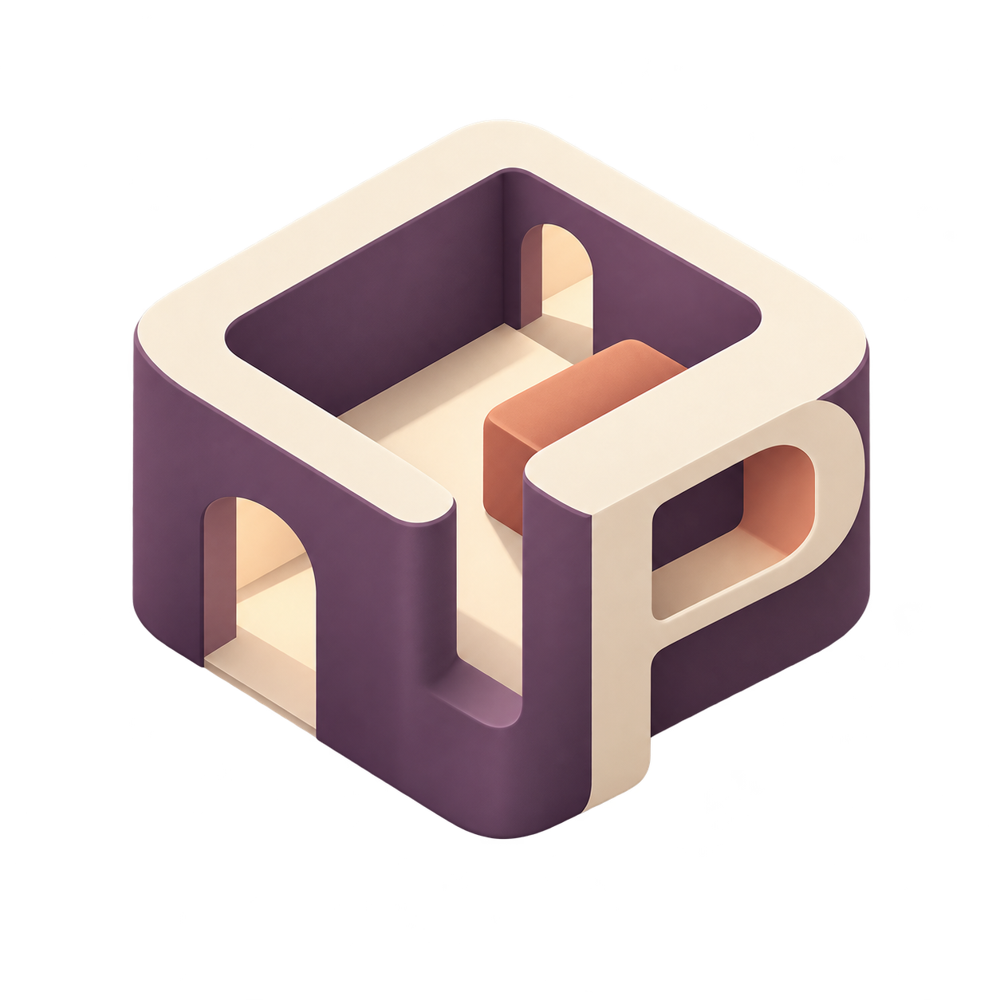
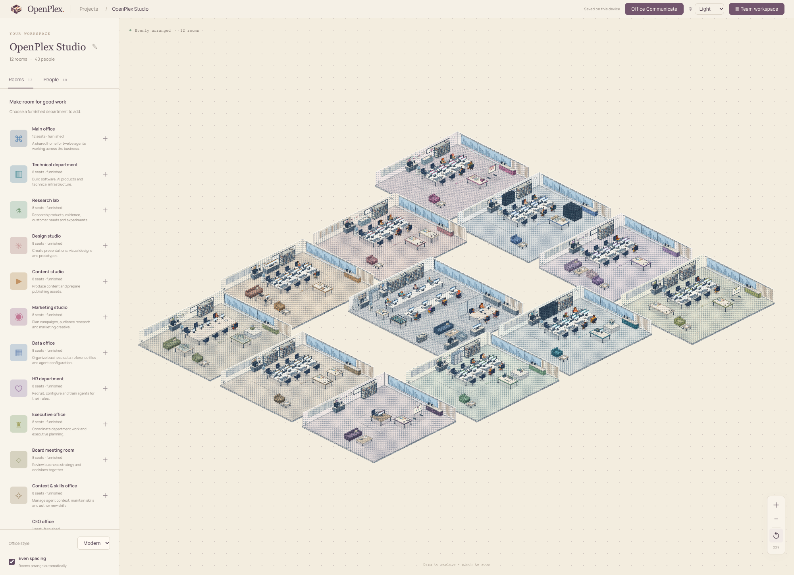
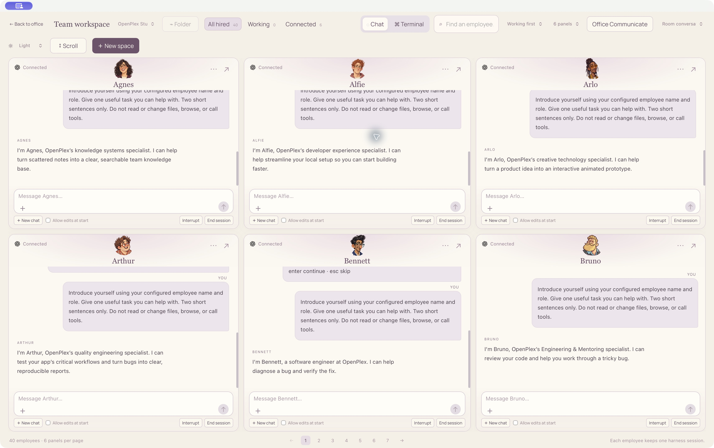
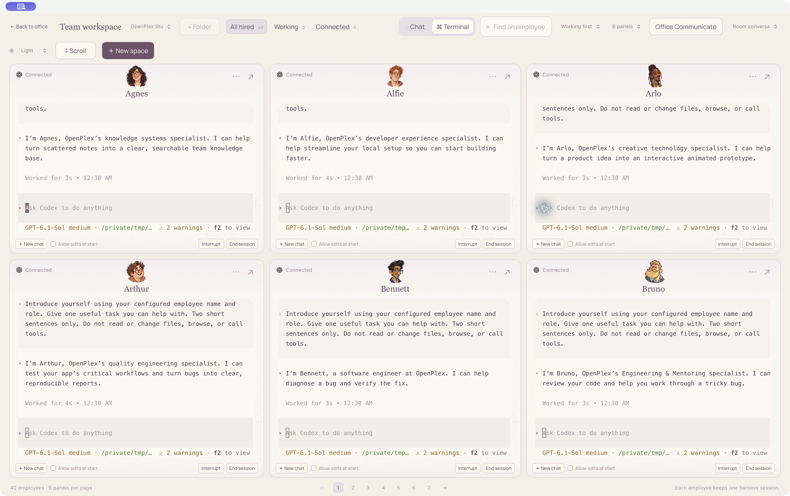
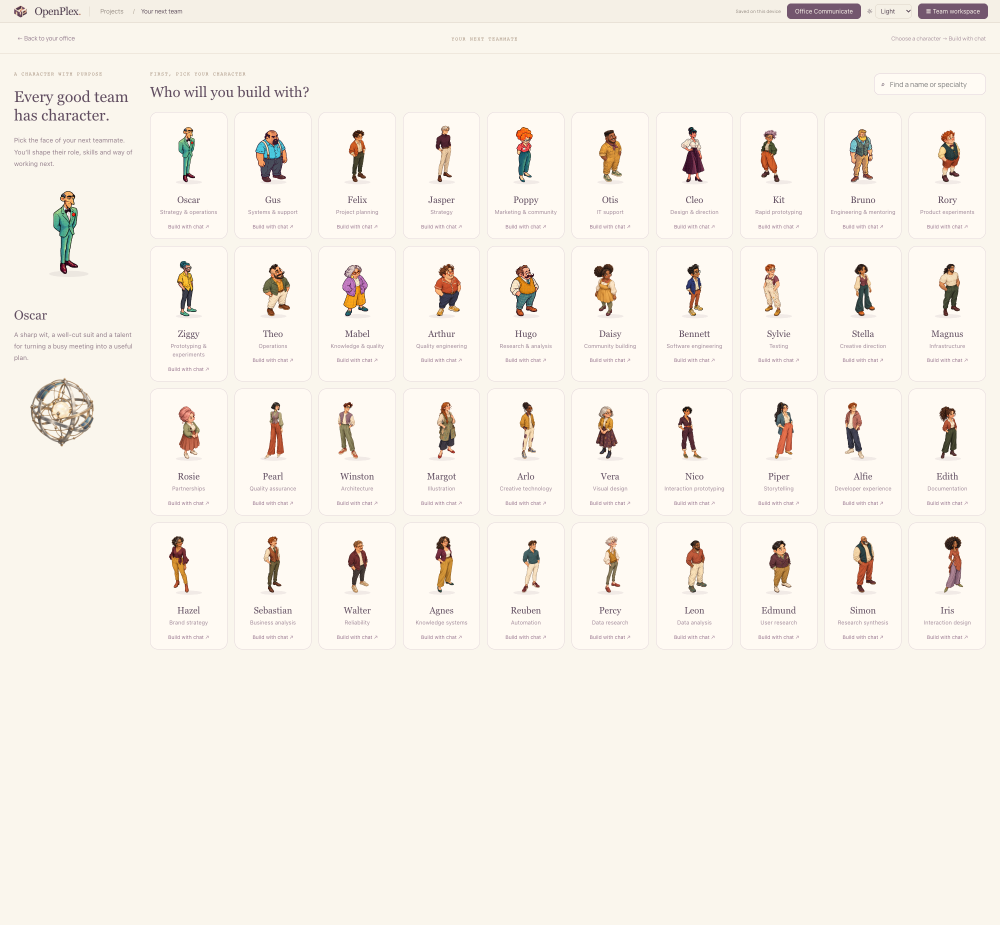

<p align="center">
  
</p>
<h1 align="center">OpenPlex</h1>
<p align="center"><strong>A place for your AI coworkers to get to work.</strong></p>
<p align="center">Local offices. Distinct characters. Real coding harnesses.</p>
<p align="center"><a href="#get-started">Get started</a> · <a href="docs/getting-started.md">Set up Codex</a> · <a href="docs/office-communicate.md">Office Communicate</a> · <a href="SECURITY.md">Security & privacy</a></p>

OpenPlex gives your agents a place you can actually see. Build an office, choose your coworkers, give each one a role, and open their chat or terminal when it is time to work. Your people can share a workspace without sharing a single tangled conversation.

This is an early, source-first release for macOS. The interface also runs in a browser, but native terminal sessions and folder access require the Mac app. Bring your own installed harness and sign-in; OpenPlex does not include model credits or promise unlimited inference.

## A small tour



**Make room for the work.** Twelve furnished rooms cover engineering, research, design, content, marketing, data, hiring, executive planning, meetings, skills and the CEO’s office. Keep them evenly arranged, move rooms by hand, and pan or zoom across the whole campus. The CEO office has one seat.



**Six conversations, one view.** Watch several coworkers side by side, narrow the list to working or connected employees, or build a space containing just the people you need. Choose one to eight panels, resize the divisions, scroll horizontally or vertically, and expand a panel when it needs your full attention.



**Use the actual terminal.** Chat and Terminal are two views of the same employee session. The terminal accepts keyboard input directly, supports resize and reconnect, and keeps each employee’s input separate. New chat starts fresh while keeping the employee’s saved setup.



**Give the work a character.** Pick from forty illustrated coworkers, then shape their name, role, system prompt, instruction files, skills, MCP configuration and plugin references. Build the profile by hand or talk it through with the employee builder. Saving a reference is not the same as installing or verifying an integration; the app keeps that distinction visible.

### A shared place to ask what is happening

Office Communicate is a Slack-style status feed for your office. Ask “What’s going on?” in all-hands for a round of updates, name a coworker for an individual reply, or address a department. The audience is shown before you send.

Each supported employee answers through a **separate reporting request** using a snapshot of its own recent work. The working chat keeps running. Replies link back to their source conversation and should distinguish completed evidence, remaining work, blockers and things the agent does not know. Codex and Claude Code have status-report adapters; other harnesses show an explicit capability limit.

This is not autonomous company management. Cross-office orchestration, a manager hierarchy and shared/vector memory are future work, not hidden features of this release.

## Get started

You need **Node.js 24 or newer**, npm, and **macOS 13 or newer with Swift command-line tools** for the desktop app. The first clone includes a few hundred megabytes of character artwork.

```sh
git clone https://github.com/himanshuchawla0807-gif/OpenPlex.git
cd OpenPlex
npm ci
npm run app:build
open output/OpenPlex.app
```

If Swift is missing, install Apple's command-line tools with `xcode-select --install`, complete the system installer, then run the build again. Builds target your Mac’s architecture. The locally built app is ad-hoc signed; there is no Developer ID-signed, notarized installer yet. Do not disable Gatekeeper or other security protections to run an untrusted download.

For an interface-only preview:

```sh
npm run dev:builder
```

Open [127.0.0.1:5180](http://127.0.0.1:5180/). A browser preview has its own local storage and cannot launch the Mac app’s native terminals.

### Connect your first coworker to Codex

1. Install and sign in to [Codex CLI](https://developers.openai.com/codex/cli). With npm: `npm install -g @openai/codex`, then run `codex` and follow its sign-in flow. Confirm that Codex works in a normal terminal first.
2. Open OpenPlex and create an office. Choose the furnished campus for a tour, or start empty and add a room.
3. Add a person, keep **Codex** as their harness, and give them a useful role and instructions.
4. Choose a workspace folder in the Mac app. This is where the employee’s configuration and work belong.
5. Open the employee’s workspace and click **Connect Codex**. Start a conversation or switch to Terminal.

No OpenAI key needs to be committed to this repository. OpenPlex uses the harness’s existing authentication. Provider subscriptions, quotas and billing still apply. See the [setup guide](docs/getting-started.md) for folder access, Claude Code, troubleshooting and session behavior.

## What is supported

| Capability | Current scope |
| --- | --- |
| Offices, characters, profiles, themes | Local app and browser preview |
| Interactive terminal adapters | Codex, Claude Code and selected other CLI adapters; capabilities vary |
| Streamed tasks and office status reports | Codex and Claude Code |
| Conversational employee builder | Codex, Claude Code, and tool-denied OpenCode text generation |
| Skills and instructions | Employee-scoped files and reviewable profile content |
| MCP | Explicit configuration and first-use trust; needs a real connection test |
| Plugins | References, not automatic installation or blanket certification |
| Scheduled tasks | App-open queue; not a background system scheduler |
| Shared office feed | Local to this app instance; not multi-user network chat |

The harness catalog includes setup-only entries. A logo in that catalog is not a claim that every provider is integrated, authenticated or tested equally. The [adapter notes](docs/harness-workspace-update.md) describe the differences.

## Privacy is a boundary, not a slogan

Offices, profiles and app conversations are saved on your device. There is no OpenPlex account or hosted sync service. The desktop UI serves bundled assets through a loopback-only web server.

**Cloud harnesses still receive the prompts and context you send them.** Selected MCP servers and vendor tools can make their own external requests. Harness transcripts, vendor telemetry and model-provider retention follow those tools’ settings. Local app storage is not application-encrypted. Read the [privacy notes](docs/privacy.md) before putting sensitive material into an employee profile or sharing work context in a channel.

## Development and checks

```sh
npm run lint
npm run build
npm test
npm run test:builder
# macOS + Swift:
npm run test:native
npm run test:terminal
npm run test:employee-workspace
npm run test:http
npm run check:release
```

The tests include malformed storage, profile merges, session isolation, stale terminal events, PTY input and resize, stopped tasks, symlink escapes, loopback request policy and reporting while private work continues. Synthetic live checks have returned replies from installed Codex and Claude Code. That is useful evidence, not a guarantee of security or support for every provider. See the [release verification](docs/release-verification.md) for scope and remaining gates.

Contributions are welcome. Start with [CONTRIBUTING.md](CONTRIBUTING.md); report vulnerabilities using [SECURITY.md](SECURITY.md). Please keep reproducible bugs separate from feature proposals and avoid posting credentials or private transcripts.

## License and credits

OpenPlex code and project-generated artwork are offered under the [MIT license](LICENSE), to the extent the contributors hold applicable rights. Provider marks retain their owners’ rights. Fonts carry their own open-font licences. Clayzo is a separately licensed dependency, not MIT-licensed OpenPlex code; its SDK is not vendored here. See [third-party notices](THIRD_PARTY_NOTICES.md) and [artwork provenance](ARTWORK.md).

The screenshots use demonstration offices and intentionally prepared tasks. A video walkthrough will be added later.

## Contributors

- [Harsh Shodey](https://github.com/harshshodey) — Helped with foundational design only.
