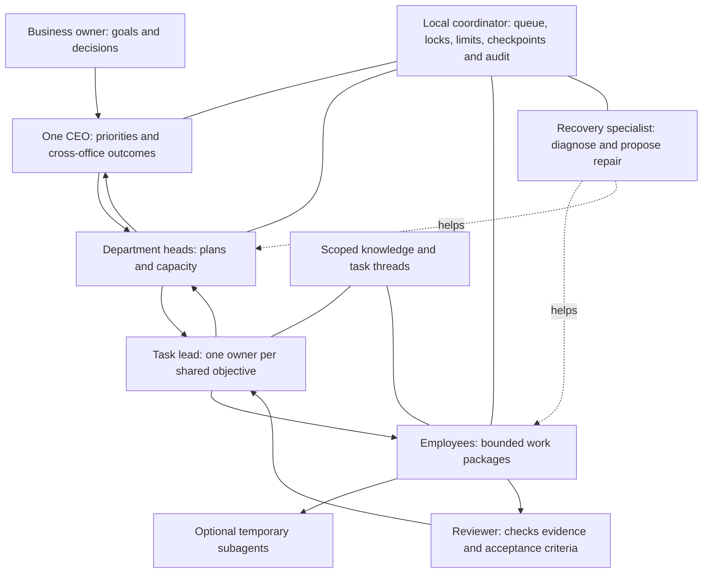

# OpenPlex local agent operating model

Design proposal · 23 October 2026. **Not implemented.** This document does not install a runtime, start agents, change permissions or enable shared memory. The texture and Scroll button changes are separate UI work.

## Decision

Ship a local orchestration helper with the desktop app, using LangGraph JS for task graphs and an application-owned SQLite database for durable tasks, messages, permissions and shared knowledge. Keep the existing harnesses as execution adapters. Do not require LangSmith hosting, a LangChain account, a paid orchestration service, Docker or a separately administered database.

There is no perfect hierarchy that guarantees an error-free business. The goal is bounded delegation, observable progress, useful recovery and a precise route for the exceptions that actually require a person. The coordinator's scheduling and access checks must be ordinary deterministic code; an LLM should not be responsible for enforcing its own limits.

## Packaging and local storage

Bundle a version-pinned JavaScript runtime, compiled coordinator and SQLite dependency in the signed application. Prefer this known-compatible runtime over relying on an arbitrary global Node/Python installation. Check the app's own manifest and database schema on startup; check installed external harnesses separately. A user-installed compatible harness may be reused with its own sign-in. Missing optional harnesses should be shown as unavailable, with an optional verified download into app-managed storage where vendor licensing permits redistribution. Do not silently execute downloaded scripts or run an administrator install.

LangGraph JS is MIT-licensed: the open-source library can be bundled and used without orchestration credits. SQLite's deliverable library is public domain. Include the applicable runtime/dependency notices and audit transitive dependencies before release. This is a technical packaging proposal, not a legal distribution review. Hosted LangSmith services are separate and optional. Model API charges, CLI subscriptions and usage limits still apply. Running the coordinator locally does not make a cloud model local; completely offline operation additionally requires a supported local model and local embeddings, with suitable hardware and explicit model downloads.

After the user selects a project folder, keep project data under:

```text
Selected project/
  .openplex/
    project.json
    state.sqlite
    employees/<stable-employee-id>/
      profile.json
      instructions/
      skills/
      conversations/<conversation-id>/
    tasks/<task-id>/
      brief.md
      artifacts/
    attachments/<content-hash>/
    backups/
```

Project-owned data belongs here, but some vendor CLIs also retain their own history/cache outside the project. Each adapter must disclose that location and use a supported project-local setting where available; do not promise all harness data is contained in this folder without verifying it.

Keep human-readable employee names in metadata; paths use stable IDs so a rename cannot break a conversation. Store the native app's folder authorization/bookmark in the OS-approved app location. Store credentials in the OS credential store or leave them with the harness, rather than putting keys into project JSON, logs or shared memory. Authenticate local IPC and do not listen on a LAN port by default. Optional model/runtime caches live in an app-managed cache location, separate from project data.

A normal local library does not need broad computer-control permission. macOS may still require permission to open the selected folder, and browser/computer-control tools can require Accessibility or Screen Recording permission. Packaging cannot bypass OS controls. If access is denied, keep unrelated tasks working and show the affected capability as blocked. A project must use a local disk for live SQLite access; a network folder should use an authenticated coordinator service rather than sharing a live SQLite/WAL file. Back up with the SQLite backup mechanism, not by copying a live database file alone.

Sources: [LangGraph JS license](https://github.com/langchain-ai/langgraphjs/blob/main/LICENSE), [SQLite public-domain statement](https://www.sqlite.org/copyright.html), [SQLite application uses](https://www.sqlite.org/whentouse.html), [SQLite WAL limitations](https://www.sqlite.org/wal.html).

## Hierarchy: a small management tree with a shared coordination layer



These are roles, not a requirement to run a separate model continuously for every box. In a small office a department head can also lead a task; a reviewer can be an idle qualified employee. The recovery specialist is a capability assigned to a configured employee, invoked when needed. Keep review independent of the author for important work. The CEO decides priorities and resolves cross-department tradeoffs; it should not relay every keystroke or approve every harmless retry.

The task lead owns one objective, its success criteria, dependencies and final integration. Each work package has one accountable employee, a defined output, due time, allowed tools, budget and review requirement. Peers can request help, but cannot silently change another department's priorities or assign unlimited extra work. Department heads approve capacity changes and cross-office help within user-configured policies.

The coordinator maintains a durable task graph, ownership leases, cancellation propagation, execution timeouts, bounded retries, per-employee queues and file/resource locks. One employee runs one work package at a time by default. Limit total model concurrency, delegation depth and spend. An initial default could be two child workers per task lead and one level of temporary subagents; these are configurable product limits, not framework limits.

Subagents are temporary task-scoped workers with a parent task ID and a restricted capability set. They receive only the minimum relevant brief and context, report a structured result and artifacts, and cannot create an unbounded tree. The parent remains accountable. Subagents do not become hired employees automatically. Cancellation, expiry and budget limits apply to the entire task tree.

## Failure handling: recovery before interruption

Every work package follows an explicit lifecycle:

`queued → running → awaiting review → completed`

Alternative states are `retry scheduled`, `waiting for dependency`, `repairing`, `needs authorization`, `blocked`, `cancelled`. A terminal producing text is not proof of success. Completion requires the expected artifact or result plus the configured verification. Track the last heartbeat and last useful progress separately, because a looping agent can remain busy without advancing.

| Failure | Automatic response within existing authorization | Escalation |
|---|---|---|
| Temporary network or service error | Classify, bounded backoff, checkpoint and retry safe operations | Recovery specialist after retry budget |
| Tool crash or lost process | Reconcile last committed output, restart/resume and verify | Department head if state cannot be recovered |
| Bad output or failing tests | Return reviewer findings to the employee with a bounded revision cycle | Alternate qualified worker, then task lead |
| Missing context or skill | Request relevant records or help from an authorized specialist | Head if the task needs a new capability |
| Conflicting file edits | Stop the conflicting write, isolate changes and integrate through the task lead | Head for unresolved design conflict |
| Rate limit or unavailable model | Queue until reset or use a pre-approved alternative | Owner only if a new cost/provider decision is needed |
| CAPTCHA, 2FA, expired credentials or newly required permission | Save state, explain the precise blocker; continue independent work | User performs the authentication/authorization step |
| Potentially irreversible action outside standing authority | Prepare a reviewable result and pause that action | Authorized human decision |

A recovery employee can diagnose an installation, repair a permitted configuration, reconstruct missing context or propose a fallback. It cannot grant itself new access, bypass a CAPTCHA/2FA, suppress provider approvals or spend money outside the configured budget. Repeating an external side effect can duplicate a purchase, email or upload, so retries need idempotency keys or receipt reconciliation. An unknown outcome must be reconciled before retrying. The user should receive one concise, actionable request rather than a stream of agent complaints.

LangGraph supports retries, timeouts and error handling, but those mechanisms require deliberate policies and version-compatible adapters. They do not automatically solve a business workflow. [Fault-tolerance documentation](https://docs.langchain.com/oss/javascript/langgraph/fault-tolerance).

## One task, several employees and cross-office help

For a product launch, the CEO approves the objective and budget. A task lead creates a shared launch thread. Research owns a sourced customer brief, Technical owns implementation and tests, Design owns assets, and Marketing/Content own the campaign. Each employee receives a separate work package linked to that thread. The thread records decisions, requests and results; files are linked by immutable artifact/version IDs rather than repeatedly pasted.

If Marketing needs a technical claim checked, it creates a help request in the launch thread. The coordinator routes it to Technical's queue or head, with the question, deadline, context references and expected answer. The assigned engineer gets only the relevant authorized material and answers in a linked help thread. The task lead incorporates the answer into the launch record. Unrelated engineering work remains in its own conversation.

Use a persistent task inbox/outbox with message IDs, reply-to IDs and delivery acknowledgements. Messages include project, task, thread, sender, recipients, scope and referenced artifact revisions. Deduplicate retries. The coordinator authenticates senders and checks recipients/scopes; prompt text cannot impersonate another employee. Prevent circular help chains, cap retries and summarize long threads. Parallel file work uses isolated worktrees or distinct files; a designated integrator resolves changes and runs the combined checks.

## Memory: three distinct things

1. **Conversation state**: messages and harness/checkpoint state for one chat. Private by default.
2. **Task state**: assignment, dependencies, decisions, progress and artifact versions shared with the task's participants.
3. **Durable knowledge**: reviewed facts, procedures and decisions discoverable beyond a single chat.

Store the authoritative records and scope metadata in SQLite. Start with FTS5 keyword search and citations. Add local semantic embeddings and a vector index only after a retrieval evaluation shows improvement. Vector similarity is not a permission system. Filter allowed scope before retrieval; keep source, author, timestamp, revision, confidence and supersession/deletion links. Avoid auto-promoting raw agent guesses into durable facts.

Memory scopes are private employee → task team → department → project across offices. Cross-project/organization memory is opt-in. The CEO gets authorized summaries and task status, not unrestricted access to every private conversation. A memory-curation job can propose a reusable note after a task completes, with verification appropriate to its importance. Deleting or correcting a note must update every search index and define how backups/retention are handled. Retrieved content remains untrusted input and cannot change tools, authority or system instructions.

LangGraph distinguishes per-thread checkpoints from cross-thread stores. Use persistent storage for production; the in-memory examples do not survive restarts. SQLite is a practical initial local persistence choice, but OpenPlex must load-test the selected checkpointer and schema rather than assuming a development example is production-ready. [Persistence documentation](https://docs.langchain.com/oss/javascript/langgraph/persistence), [FTS5](https://www.sqlite.org/fts5.html).

## Multiple chats for one employee

Current implementation observation: the UI/native bridge primarily addresses a harness session by employee key. That is adequate for one chat, but multiple chats require a conversation registry. This proposal does not change that runtime yet.

Separate these identities:

| Identity | Meaning |
|---|---|
| Employee ID | Persistent person, profile, configured skills and permissions |
| Conversation ID | One independently resumable chat with that employee |
| Harness thread ID | That CLI/provider's resume identifier for this conversation |
| Run ID | One execution attempt/turn, including retries |
| Task/team thread ID | Shared business objective, optionally linked to many personal conversations |

**New chat** creates a fresh conversation ID and a fresh harness context. Inject the employee identity and profile revision, project scope, relevant approved knowledge and any explicitly linked task brief. Do not resume the previous harness thread or copy its transcript. The system knows it is a new chat from structured IDs and the adapter's launch mode, not by hoping the model understands a sentence saying “new chat.” Keep `New chat`, `Continue`, and `Fork with selected context` distinct.

A thread list in each employee view could show title, task, last activity and running/queued/blocked state. The tile represents the employee; opening it exposes the selected chat. Chat and Terminal are two views of the same selected conversation. Switching views never starts another run. Switching chats changes the view binding; it must not send input into whichever PTY happens to be running.

Bind every input/output event to project ID, employee ID, conversation ID, run ID and native session generation. Ignore stale tokens from closed/replaced runs. Persist each conversation's harness resume mapping. A user-entered line in a raw CLI is captured in that conversation only. When a harness cannot reliably identify/resume multiple threads, show the capability limit rather than claiming separate contexts.

Default to one active execution per employee, with other chat turns queued. A background conversation can finish while the user reads another; clearly label which chat is running. Offer `Stop and switch` without silently discarding the old run. Parallel conversations may be a later advanced option, using separate isolated native sessions and explicit resource/budget limits—never two chats writing into one PTY. On restart, reconcile running jobs with actual process/thread state before re-queueing; do not blindly resubmit side effects.

An employee may create task-bound help/subagent conversations through the coordinator within its policy. Those are visible child threads with the initiating employee, parent task and participants. They do not inherit every private chat or become a new permanent hire.

## Delivery and proof before release

1. Package the pinned local helper and local database; verify install, upgrade rollback, folder denial, backup/restore, offline coordinator startup and dependency notices. No mandatory cloud orchestration account.
2. Add the conversation registry and certified start/resume/interrupt/close adapters for two harnesses. Test new-chat isolation, stale events, wrong-thread input, crash recovery and profile revision handling.
3. Add the task ledger, bounded queues, reviewer and recovery workflow. Test duplicate events, ambiguous side effects, timeouts, permission boundaries and cancellation.
4. Pilot one task lead with two workers and scoped task memory. Evaluate correctness, recovery success, cost, latency and unnecessary user interruptions.
5. Add cross-department help and project-wide knowledge after isolation and conflict tests pass. Evaluate semantic memory against the keyword baseline before adding it.

Do not market this as a fully autonomous, failure-free business operator. Publish measured capabilities per harness and retain a clear audit trail and stop control. Begin with one narrow, verifiable end-to-end workflow and broaden only after it works reliably.
