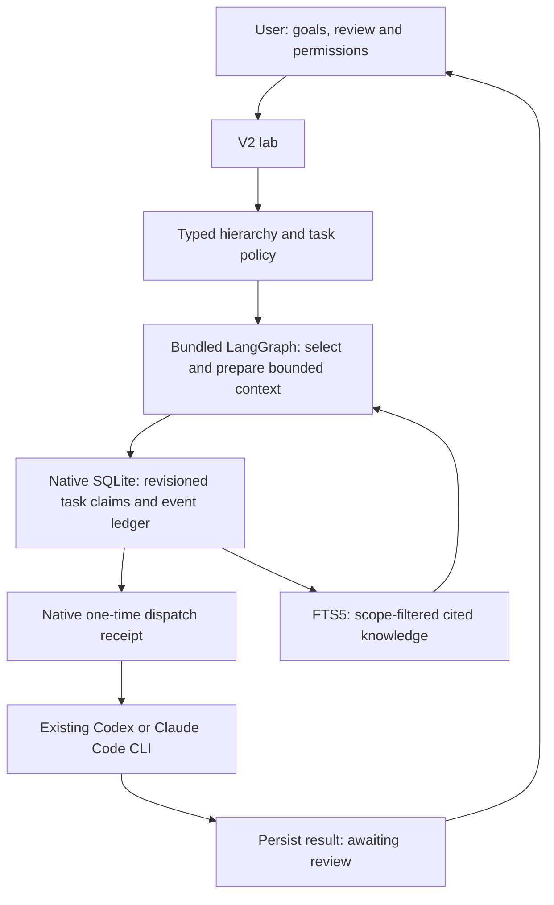

# V2 coordination pilot

4 November 2026. Development branch: `codex/v2-coordination`.

This is the first working slice of the hierarchy and memory design. It is a local,
user-directed analysis pilot, not a release of autonomous company management.
The public v1 app and website are unchanged.

## Try it

```sh
git switch codex/v2-coordination
npm ci
npm run app:v2
open output/OpenPlex-v2.app
```

The separate local app is ad-hoc signed, not notarized. Open a project, select
**V2 lab**, and choose a local workspace folder. Browser previews do not execute
workers or fall back to pretending that in-memory data is durable.

1. Open **Reporting lines**, import hired employees, assign a head and two direct
   reports, then save. Roles include CEO, head, employee, reviewer, and recovery.
   A project can have one CEO; cyclic and excessively deep reporting lines fail.
2. Select **Create a safe pilot** in Tasks. It creates one lead-owned objective
   with two delegated checklist drafts for an imaginary product. It is idempotent.
3. **Run ready tasks** dispatches up to two eligible tasks. Run it again for queued
   work once capacity is available. There is no unattended polling loop making
   additional model calls. Existing employee terminals and tasks reserve their
   employee and are excluded from dispatch.
4. Read results and accept them explicitly. A successful CLI exit means
   **awaiting review**, not completed. Complete children before accepting their
   parent. Reconcile failed attempts before retrying; default budget is two attempts.
5. Use **Propose a shared note** on completed output. Choose a scope, retain a
   source citation, and publish only material you have reviewed. Corrections
   supersede a prior revision without widening its scope; deletion removes content
   from active state and the search index.
6. Search knowledge through local FTS5. **View as** previews what an employee may
   retrieve. A CEO does not automatically read private notes belonging to others.
7. Help Threads saves addressed questions and replies linked to a task. An
   addressed helper can reply without joining the task or gaining private memory.
   A request does not itself start a model or reassign work.

Blocked tasks can request an assessment from a configured recovery employee.
That creates a bounded, tool-free diagnostic task. It cannot repair the computer,
grant permissions, resolve login challenges, or automatically retry the original
task. Authentication and new permissions remain explicit human decisions.

## What runs locally



The pinned LangGraph 1.6.0 library is compiled into a lazily loaded web chunk in
the desktop bundle. The existing Swift host uses macOS SQLite directly. This
pilot therefore needs no downloaded coordinator runtime, Node installation at
launch, Docker, hosted database, LangSmith account or orchestration credits.
The v2 panel adds approximately 272 KB gzip of JavaScript on first opening;
it does not load the graph into the initial v1 workspace chunk.

LangGraph prepares each dispatch batch. It is not presently running a persistent
LLM supervisor, and no claim is made that its in-memory graph state is a durable
checkpoint. The authoritative lifecycle and knowledge records are in SQLite.
Cloud-backed harnesses still transmit selected context to their providers and
consume the user's allowance. No model or embedding weights are bundled.

Project data is isolated by project identity, even if two offices select the same
parent folder:

```text
Selected project/.openplex/v2/<SHA256 of project ID>/
  state.sqlite
  state.sqlite-wal / state.sqlite-shm  (when SQLite needs them)
  backups/v2-<UUID>.sqlite
```

The document and FTS index commit in one transaction. Saves use an expected
revision to reject conflicting windows rather than overwrite their work.
Backups use SQLite's backup API and become standalone snapshots without a WAL
dependency. Managed database and backup files are private to the OS user.
Symlinked managed paths and network volumes are rejected.

## Execution and sharing boundaries

- Each attempt has a task ID, employee ID and fresh run ID. Native dispatch
  rechecks the persisted claim and commits a unique receipt before spawning.
  Replaying a consumed run fails, including after a process restart.
- The native bridge accepts only the app's loopback main frame. There is no new
  HTTP coordinator API or listening LAN service. The trusted user interface owns
  state changes. **No model-callable delegation or memory tools are exposed yet.**
  Before adding them, identity must be bound to the native session rather than a
  model-supplied `actorId`. The user-facing reader preview is not authentication.
- The first adapters reuse the existing tool-free reporting isolation: Codex
  shell, agents, plugins, hooks, search and configured MCP tools are disabled;
  Claude uses safe mode, no tools and strict empty MCP configuration. These
  conversations retain employee identity/instruction content, but do not activate
  their skills or integrations. They cannot execute implementation tasks.
- Two concurrent attempts, one per employee, a native ten-minute deadline,
  independent review and bounded retries are enforced. Cancellation propagates
  through children and dependents and interrupts owned running attempts. Native
  process termination is kept distinct from a streamed turn error.
- Switching projects unmounts the old coordinator and stops its owned attempts.
  Closing just the lab panel leaves its observer mounted. An interrupted or
  expired attempt is blocked on reload; it is never automatically resubmitted.
- Private employee notes, task participants, department members and project
  membership determine retrieval. Scope filtering precedes the FTS query's
  ranking and limit. Work context includes bounded excerpts and citations, not
  every employee transcript. A dependency does not grant access to another
  employee’s private result; share an authorized note or task participation explicitly. Retrieved text cannot change policy or permissions.
- Deletion clears active note content and FTS entries. Previously created backups,
  already-sent provider prompts and prior task outputs may still contain copies.
  Secure erasure, encrypted storage, backup retention and remote deletion are not
  claimed. Protect the device and its backups accordingly.

## Verification performed

| Check | Result |
| --- | --- |
| Domain and controller | 31 tests passed: hierarchy, duplicates, limits, dependencies, review, isolation, stale replies, interruption, cancellation, recovery assessment and failed commits |
| Native SQLite | 38 checks passed: reopen, project isolation, permission-filtered FTS, revisions, rollback, backup, corrupt records, symlinks and dispatch receipts |
| Native end-to-end | Both Codex and Claude protocol fixtures passed through the actual LangGraph → Swift SQLite → native process → result/review → backup → restart path; fixtures make no provider calls |
| Native runtime regression | Codex/Claude/OpenCode protocol and ownership tests passed, including fresh tool-free v2 runs and a native deadline without a WebKit timer |
| Existing builder | 72 tests passed |
| Office/animation regression | 70 passed, one pre-existing archived-art hash test skipped |
| PTY, employee configuration, HTTP boundary | Existing suites passed |
| Build and package | TypeScript/Vite and Swift builds passed; a separate ad-hoc signed local v2 app was built |
| Dependency audit | npm reported zero known vulnerabilities at verification time; this is not proof of vulnerability absence |
| Native user interface | Created a separate pilot office, authorized an isolated folder, imported hires, saved reporting lines, created delegated work, reviewed results, published a cited note, searched FTS5 and created a backup |
| Live Codex | Three short, tool-free reasoning calls for Oscar/Poppy/Cleo returned explicit proposed work and limitations; each was accepted only after review |
| Live Claude account | Not tested; deterministic Claude protocol fixtures passed |

REA static inventory of the existing builder parsed 47 JavaScript/TypeScript
sources with no parse failures. Parent evidence:
`ev_612ec09a483458c38382411cdb70dada6b49c0d13fcd9e57eee80bc83f62a659`.
Semantic coverage was partial with unresolved dynamic flows; this is static
evidence, not runtime certification. Tests and native UI checks establish the
runtime observations above.

To repeat the focused checks:

```sh
npm run test:v2
npm run test:v2-store
npm run test:v2-e2e
npm run test:native
npm run lint
npm run app:v2
```

## Next work before broader V2 use

1. Evaluate live Claude and pinned provider versions, including failure and
   cancellation behavior. Keep unsupported adapters explicitly unavailable.
2. Add a persistent conversation registry with selected/resumable chat IDs and
   profile revisions. The pilot has fresh attempt conversations and an audit
   ledger; it is not yet the proposed multi-chat employee history browser.
3. Let a lead propose structured task plans and a reviewer propose findings,
   with deterministic validation, visible approval and a measured narrow pilot.
   Current delegation is created by the user or the safe-pilot action.
4. Add session-authenticated coordinator tools, reviewed help routing and isolated
   file worktrees before enabling worker tools or automatic repairs. Implement
   budget accounting rather than treating concurrency/time limits as a spend cap.
5. Measure retrieval usefulness and task completion on real work. Add local vector
   search only if it improves on the FTS5 baseline. Organization-wide sharing,
   cross-project promotion and LAN collaboration remain unimplemented.
6. Add backup/restore UX, retention controls, migrations, accessibility and small-
   screen QA, a dedicated threat review, performance testing and notarization
   before a public v2 release. Large graph/PDF chunks still trigger Vite's bundle
   size advisory; these are lazy-loaded rather than hidden from the report.
